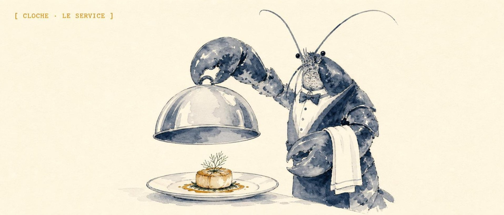
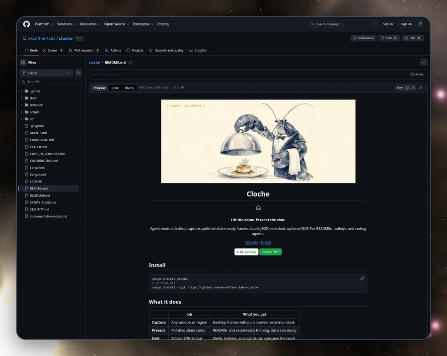
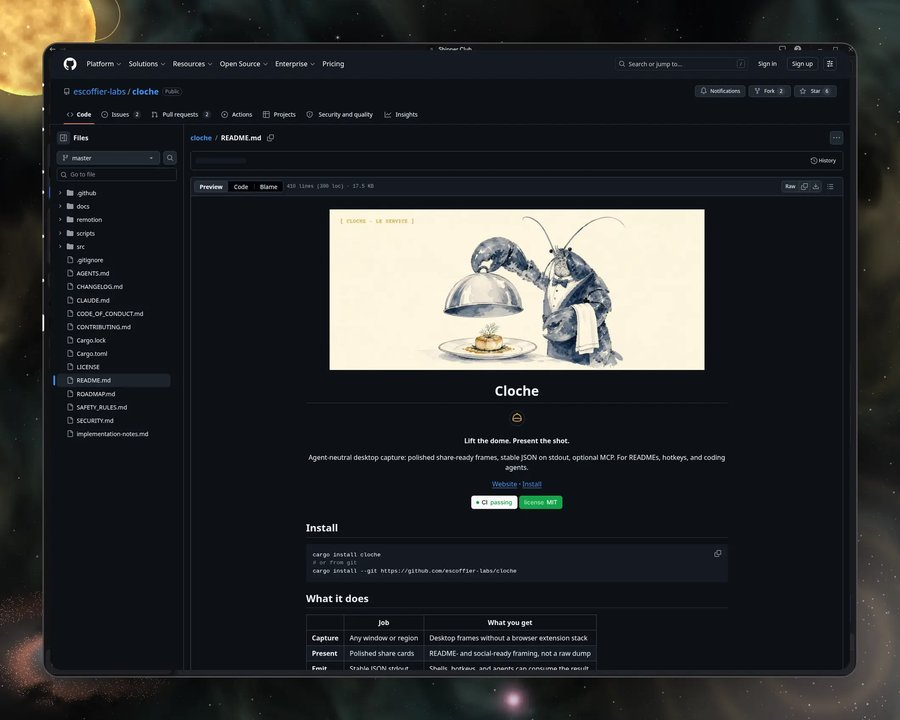
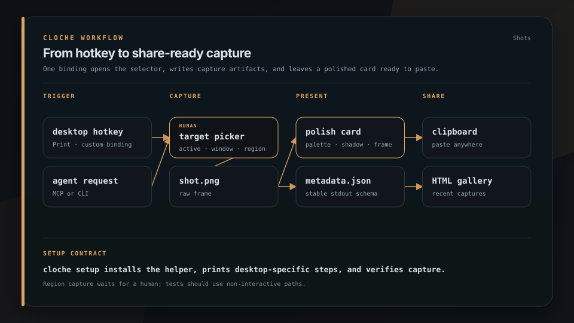

<p align="center">
  
</p>

<h1 align="center">Cloche</h1>

<p align="center">
  
</p>

<p align="center">
  <strong>Lift the dome. Present the shot.</strong>
</p>

<p align="center">
  Agent-neutral desktop capture: polished share-ready frames, stable JSON on stdout, optional MCP. For READMEs, hotkeys, and coding agents.
</p>

<p align="center">
  <a href="https://cloche.escoffierlabs.dev">Website</a> &middot; <a href="#install">Install</a>
</p>

<p align="center">
  
  
</p>

## Install

```bash
cargo install cloche
# or from git
cargo install --git https://github.com/escoffier-labs/cloche
```

## What it does

| | Job | What you get |
|---|---|---|
| **Capture** | Any window or region | Desktop frames without a browser extension stack |
| **Present** | Polished share cards | README- and social-ready framing, not a raw dump |
| **Emit** | Stable JSON stdout | Shells, hotkeys, and agents can consume the result |
| **Serve** | Optional MCP | Expose capture to coding agents when you want it |

## Examples

Same proof cards as the [website](https://cloche.escoffierlabs.dev): a GitHub
README capture, polished onto two deep-space skies.

<p align="center">
  
  &nbsp;
  
</p>

<p align="center">
  <sub>readme · milkyway-core · seed 3 &nbsp;·&nbsp; readme · carina-hubble · jwst · seed 42</sub>
</p>

```bash
cloche polish shot.png --palette milkyway-core --scene sun --style-seed 3
cloche polish shot.png --palette carina-hubble --scene jwst --style-seed 42
```

Every card sits in a sky drawn from noise at render time. Pin a palette or a
telescope look; the same `--style-seed` reproduces one sky exactly:

<p align="center">
  
  
  
  
  
  
</p>

```bash
cloche polish shot.png --palette horsehead-flame --scene alma --style-seed 7
```

See [Backdrops](#backdrops) for every family and how to list them.
Live Studio and more samples: [cloche.escoffierlabs.dev](https://cloche.escoffierlabs.dev).

## Quick Start

Capture the active app or window as a Shot:

```bash
OUT=/tmp/cloche-demo
cloche capture --target active --out-dir "$OUT" --format json
```

Style an existing screenshot into a presentation card without recapturing:

```bash
cloche polish /tmp/diff.png --palette milkyway-core --format json
```

By default the card sits on a procedural deep-space scene. Pick one instead of
letting the seed choose:

```bash
cloche polish /tmp/diff.png --scene jwst --style-seed 12345
```

See [Backdrops](#backdrops) for the other families.

Preview the latest capture:

```bash
cloche preview
```

Create a self-contained HTML gallery of recent Shots:

```bash
cloche gallery --root /tmp --html /tmp/cloche.html --title "My Shots" --open
```

Generate a Codex `turn/start` payload from a Shot (pass the out-dir, or a
`<stem>.json` sidecar):

```bash
cloche codex-payload --thread-id "$THREAD_ID" "$OUT"
```

## Backdrops

Every card is framed on a procedural backdrop drawn from the style seed. Nothing
is a stock image or a tiled bitmap: each one is generated from noise at render
time, so the same `--style-seed` reproduces a card exactly. There are five
families. A palette carries the colors, and every family except gradient has a
second axis that carries the structure:

| Family | Palettes | Second axis (flag) | What it draws |
|---|---|---|---|
| Space | deep-space `--palette` names | `--scene` | nebulae, starfields, telescope looks |
| Pattern | woven and ruled `--palette` names | `--motif` | plaid, weave, grid, and similar cloth or paper |
| Sky | sky `--palette` names | `--sky` | cloud decks, storms, lightning, twilight, aurora |
| Terrain | terrain `--palette` names | `--terrain` | dunes, mesa, badlands, glacier |
| Gradient | soft gradient `--palette` names | none | a gradient with glows and light streaks |

`cloche config options` prints the live catalog: every palette with its kind,
plus every scene, motif, sky, and terrain. Use it instead of a count in the
docs, since the lists grow. The sections below describe each family.

By default only the space palettes are in the random rotation. The other
families appear when you name a palette with `--palette`, or list them in the
random pool (see [Backdrop Preferences](#backdrop-preferences)). A second-axis
flag applies only to its own family; on any other palette it is a no-op
warning.

### Space backdrops

The palettes are color-sampled from astrophotography of real objects, and a
scene layers gas, dust lanes, starfields, and one or more focal objects on top:

- **Nebulae:** domain-warped clouds with bright ionization fronts and dark
  dust lanes. Palettes: `orion-emission`, `carina-hubble`, `pleiades-reflection`,
  `rho-ophiuchi`, `milkyway-core`, `andromeda-haze`, `horsehead-flame`,
  `lagoon-trifid`.
- **Telescope looks:** roughly half of scenes take the JWST signature (6-point
  diffraction spikes, clumpy dust, blue-cored galaxies). Others echo ALMA
  protoplanetary discs, SDO extreme-UV suns with coronal loops, and Chandra
  supernova-remnant shells.
- **Objects:** spiral and edge-on dust-lane galaxies, ring and bipolar
  planetary nebulae, open clusters, gravitational-lensing arcs, and rare
  ultra-deep-field and Planck-CMB frames.

The deep-space palettes are the default random rotation: `orion-emission`,
`carina-hubble`, `pleiades-reflection`, `rho-ophiuchi`, `milkyway-core`,
`andromeda-haze`, `horsehead-flame`, `lagoon-trifid`, `eagle-pillars`,
`crab-remnant`, `tarantula-web`, and `sombrero-dust`.

Pin a look with `--scene` instead of rolling the seed:

```bash
cloche polish shot.png --scene alma
cloche polish shot.png --scene cmb --style-seed 42
```

Scenes: `nebula`, `jwst`, `hubble`, `galaxy`, `alma`, `ring`, `butterfly`,
`edge-on`, `sun`, `sdo`, `cluster`, `deep-field`, `lensing`, `veil`, `remnant`,
`cmb`. `--scene` applies only to space palettes. `--palette` and the second-axis
flags (`--scene`, `--motif`, `--sky`, `--terrain`) are available on
`cloche capture`, `cloche polish`, and the matching MCP tools.

### Pattern backdrops

Woven and ruled geometry, drawn from the seed the same way the space scenes are. A pattern palette carries the colours and a
motif carries the structure, so `--palette` and `--motif` compose exactly like
`--palette` and `--scene`.

```bash
cloche polish shot.png --palette tartan-moss --motif plaid
cloche polish shot.png --palette blueprint --motif grid --style-seed 42
```

Pattern palettes: `tartan-moss`, `oxford-navy`, `blueprint`, `ledger-cream`,
`picnic-red`, `workshop-ochre`. `ledger-cream` and `picnic-red` are light
grounds, which give a card a very different weight from the dark skies.

Motifs: `plaid`, `gingham`, `stripe`, `rule`, `grid`, `diagonal`, `chevron`,
`dot`, `crosshatch`, `weave`, `herringbone`, `houndstooth`. `--motif` applies
only to pattern palettes; on any other backdrop it is a no-op warning, the same
way `--scene` behaves off a space palette.

Nothing is a tiled bitmap. Plaid builds a mirrored tartan sett and crosses it
both ways; houndstooth is derived from a 2/2 twill with a four-thread colour
repeat, which is what actually grows the teeth. Both resolve cleanly at any card
size.

### Sky backdrops

Cloud decks, storms, lightning, and twilight, drawn as a banded ramp plus one
structural feature. The palettes are sampled from photographs of the named
conditions: `blue-hour`, `golden-hour`, `supercell`, `mammatus`,
`aurora-curtain`, `cirrus-blue`, and `alpenglow`. `--sky` pins the condition:
`blue-hour`, `golden-hour`, `overcast`, `cirrus`, `mackerel`, `mammatus`,
`storm`, `bolt`, `crepuscular`, or `aurora`.

```bash
cloche polish shot.png --palette supercell --sky bolt
cloche polish shot.png --palette alpenglow --sky crepuscular --style-seed 42
```

### Terrain backdrops

A cross-section of ground: sky above a horizon, rock, sand, or ice below. The four
palettes (`dunes`, `mesa`, `badlands`, `glacier`) and the four `--terrain`
kinds share those names.

```bash
cloche polish shot.png --palette mesa --terrain mesa
cloche polish shot.png --palette glacier --terrain glacier --style-seed 7
```

### Gradient backdrops

The original look: a soft three-stop gradient with glows and light streaks.
There is no second axis. Gradient palettes are `violet-haze`, `ember-glow`,
`aurora-teal`, `rose-noir`, `midnight-sky`, `sea-glass`, `peach-dusk`,
`ink-wash`, and `citrus-noon`.

`cloche studio` shows the cross product for the space, pattern, and gradient
families: hover a backdrop and the scene or motif sheet redraws on it. The page
does not list the sky and terrain palettes yet, so set those with `--palette`
or `cloche config set`.

## Backdrop Preferences

Pinning a look on every invocation gets old, so `cloche config` stores the
choice once and both `capture` and `polish` read it with no flags:

```bash
cloche config options                 # every palette (with kind), scene, motif, sky, terrain
cloche config show                    # current preferences and where they live

# Always use one backdrop.
cloche config set --mode pinned --palette orion-emission --scene jwst

# Or keep it random, but only across the backdrops you like.
cloche config set --mode random --palettes carina-hubble,pleiades-reflection
cloche config set --scenes alma,veil
cloche config set --palettes tartan-moss,oxford-navy --motifs plaid,houndstooth
cloche config set --palettes supercell,alpenglow --skies bolt,crepuscular

cloche config set --clear all         # back to defaults
```

Preferences live at `~/.config/cloche/config.json`
(`$XDG_CONFIG_HOME`/`%APPDATA%` are honored, and `CLOCHE_CONFIG` overrides the
path outright):

```json
{
  "polish": {
    "mode": "random",
    "palette": null,
    "scene": null,
    "motif": null,
    "sky": null,
    "terrain": null,
    "palettes": ["carina-hubble", "pleiades-reflection"],
    "scenes": ["alma", "veil"],
    "motifs": ["plaid", "houndstooth"],
    "skies": [],
    "terrains": []
  }
}
```

- `mode` is `random` or `pinned`. `pinned` applies `palette` and its
  `scene`, `motif`, `sky`, or `terrain`; `random` leaves them on file and draws
  from the pools instead.
- `palettes`, `scenes`, `motifs`, `skies`, and `terrains` are the random pools.
  Empty means no constraint: every deep-space palette, and the seed's own pick
  on the second axis. Naming a gradient, pattern, sky, or terrain palette here
  is how those families get into the random rotation.
- Precedence is flag, then config, then the built-in random pick, so a one-off
  `--palette` always wins.
- A missing file means defaults. A malformed one is reported in the result's
  `warnings` and falls back to defaults rather than costing you the capture.

`cloche config show` and `cloche config options` emit the same JSON contract as
every other command (`cloche schema --for config`).

### cloche studio

If you would rather see the backdrops than read their names:

```bash
cloche studio              # http://127.0.0.1:4317
cloche studio --port 0     # let the OS pick a port
cloche studio --print-url  # print the URL as JSON and exit
```

A local page showing the space, gradient, and pattern backdrops, and every
scene and motif, as real renders. Click to switch one in or out of the random
pool, or switch to Pin one to lock a single backdrop. Changes are written to the
same `config.json` the CLI reads, and the page shows the equivalent
`cloche config set` for whatever you have selected. Sky and terrain backdrops
are not on the page yet.

The hero preview uses your newest capture, so the page will display whatever you
last screenshotted. Worth knowing before you screen-share it.

It binds to `127.0.0.1` by default and has no authentication, because anything
that can reach the port can rewrite your styling config. `--host` widens that:
only use it on a network you trust.

## Command Reference

```bash
cloche doctor --format json
cloche list-windows --format json
cloche capture --target active --presentation both --format json
cloche capture --target active --detail high --style-seed 12345 --out-dir /tmp/cloche-demo --format json
cloche capture --target screen --out-dir /tmp/cloche-demo --format json
cloche capture --target window --title Firefox --out-dir /tmp/cloche-demo --format json
cloche capture --target window --window-id 0x3400003 --out-dir /tmp/cloche-demo --format json
cloche capture --target window --app firefox --out-dir /tmp/cloche-demo --format json
cloche capture --target region --presentation both --clipboard --out-dir /tmp/cloche-demo --format json
cloche capture --target active --palette orion-emission --scene jwst --out-dir /tmp/cloche-demo
cloche polish /tmp/diff.png --format json
cloche polish /tmp/diff.png --out /tmp/diff-card.png --palette ember-glow --scene jwst --style-seed 12345
cloche config show
cloche config options
cloche config set --mode pinned --palette orion-emission --scene jwst
cloche config set --mode pinned --palette tartan-moss --motif houndstooth
cloche config set --mode pinned --palette supercell --sky bolt
cloche config set --mode pinned --palette mesa --terrain mesa
cloche config set --mode random --palettes carina-hubble,pleiades-reflection
cloche config set --motifs plaid,gingham,houndstooth
cloche config set --clear all
cloche studio
cloche studio --port 0 --print-url
cloche gallery --limit 10
cloche gallery --root /tmp --html /tmp/cloche.html --title "My Shots" --open
cloche latest
cloche preview
cloche open /tmp/cloche-demo
cloche schema
cloche schema --for polish
cloche schema --for config
cloche codex-payload --thread-id THREAD_ID /tmp/cloche-demo
cloche codex-payload --thread-id THREAD_ID --card /tmp/cloche-demo
cloche mcp
cloche setup
cloche setup --print
cloche setup hotkey
cloche setup agent --client claude-code
cloche setup verify --format json
```

Omit `--out-dir` on capture to write into the default gallery (`~/Pictures/Cloche`).
The old `appshots` command remains as an alias for the same code path.

## Modes

**Shots** are the product. A Shot is a still capture with raw and presentation images, metadata, and optional extracted text.

## Why Cloche Exists

OpenAI documents Appshots as a macOS app feature for Codex. The Codex repository can already resume threads that contain local images through app-server v2 `turn/start` input:

```json
{ "type": "localImage", "path": "/absolute/path/to/shot.png", "detail": "high" }
```

Linux and Windows users still need a reliable way to create those captures from a normal CLI. Cloche fills that capture side while staying independent of any one agent stack. Use it with Codex, OpenClaw, Claude Code, Hermes, a local MCP client, or a plain shell script.

Reference: <https://developers.openai.com/codex/appshots>

## Output Files

By default each capture writes flat files into `~/Pictures/Cloche` (override
with `--out-dir`). Files share one stem (`cloche-shot-<UTC>Z-<pid>-<n>`):

- `<stem>.png`, the shareable card (or the raw shot when `--presentation raw`).
- `<stem>.raw.png`, the raw capture when a card owns `<stem>.png`.
- `<stem>.json`, the same JSON object printed to stdout.
- `<stem>.txt`, optional best-effort accessible text from the focused app.

Legacy folder-per-shot captures (`shot.png`, `shot-card.png`, `metadata.json`,
`text.txt`) are still readable by `gallery`, `latest`, and `preview`.

Capture exits with `0` only when a raw image was written. Text extraction and presentation-image failures are warnings because accessibility support and desktop compositing vary by toolkit, app, desktop environment, and OS. `--target screen` exists as a fallback and debugging mode. `--target active` is the default.

Use `--presentation raw`, `--presentation card`, or `--presentation both` to control output image generation. Use `--style-seed <number>` to reproduce a randomized card style exactly. Use `--detail high|low|auto|original` for the Codex `localImage` detail hint stored in metadata.

`--target region` opens an interactive selector (Flameshot when available, ImageMagick `import` drag-select on X11): drag a rectangle and the shot is taken the moment you release. Add `--clipboard` to copy the finished card straight to the clipboard (wl-copy on Wayland, a detached Cloche arboard server on X11, an in-process arboard write on Windows). X11 clipboard copy waits up to 3 seconds for ownership and rejects input PNG files above 15 MiB. The flag records a warning and the capture still succeeds. Region capture needs a human at the desk. It is not for headless agents. Region select itself is also not yet supported on Windows: use Win+Shift+S, save the file, then `cloche polish <file>`.

## Hotkey Workflow

Bind one key to get a share-ready card on your clipboard: press it, drag a
region, paste the polished card anywhere. The capture, polish, and clipboard
copy all happen in cloche; only the key binding is set up per desktop.



Generated from [`docs/assets/workflows/hotkey.json`](docs/assets/workflows/hotkey.json) with `plating workflow`.

The fastest path is one command:

```bash
cloche setup
```

It installs `cloche-grab`, binds it to Print on GNOME (and prints the exact
steps on KDE/sway/i3), registers the MCP server with any agent it detects, then
verifies that capture, the hotkey, and the MCP server actually work. Run
`cloche setup --print` to preview every change first, or `cloche setup verify`
any time to re-check. The manual steps below are what `cloche setup` automates,
and the fallback for unsupported desktops.

The repo ships `scripts/cloche-grab.sh`, which wraps the capture and adds a
desktop notification. Install it and bind it:

```bash
# 1. Put the script on your PATH (or point the binding at it in place).
install -Dm755 scripts/cloche-grab.sh ~/.local/bin/cloche-grab

# 2. Confirm it works (it opens the region selector):
cloche-grab
```

Then bind `cloche-grab` to a key:

- **GNOME:** Settings -> Keyboard -> View and Customize Shortcuts -> Custom
  Shortcuts -> +. Name it "Cloche Grab", command `cloche-grab`, and set the
  shortcut (e.g. Print). To move the native screenshot UI off Print first:
  `gsettings set org.gnome.shell.keybindings show-screenshot-ui "['<Shift>Print']"`.
- **KDE:** System Settings -> Shortcuts -> Custom Shortcuts -> Edit -> New ->
  Global Shortcut -> Command/URL, command `cloche-grab`, then assign a key.
- **Anything else (sway, i3, ...):** bind a key to `cloche-grab` in your WM
  config.

Prefer no script? Bind this one-liner directly instead:

```bash
cloche capture --target region --presentation both --clipboard
```

`cloche polish` writes a single card PNG (`<input>-card.png` next to the
input by default, or `--out <path>`; it must end in `.png`). Its stdout JSON
reports `input`, `card`, and `presentationStyle`.

## Agent Use

Any shell-capable agent can call:

```bash
OUT=/tmp/cloche-demo
cloche capture --target active --out-dir "$OUT" --format json
```

Then parse `image.path` from stdout or read the generated `<stem>.json` sidecar
in `$OUT`. `image.path` is the raw frame (`<stem>.raw.png` when a card was
written); the polished card lives at `presentationImage.path`.

Codex app-server clients can turn a capture into a ready `turn/start` payload.
By default `codex-payload` attaches that raw frame (the unstyled pixels). Pass
`--card` to attach the polished presentation image instead:

```bash
cloche codex-payload --thread-id "$THREAD_ID" "$OUT"
cloche codex-payload --thread-id "$THREAD_ID" --card "$OUT"
```

Other agents should treat Cloche as a normal subprocess tool. The core command has no MCP dependency, desktop-app dependency, or agent-specific runtime dependency.

## MCP Server

`cloche mcp` runs a minimal stdio MCP server for clients that prefer the Model Context Protocol over direct subprocess calls. It speaks newline-delimited JSON-RPC 2.0 on stdin/stdout and exposes `capture`, `polish`, `list_windows`, `doctor`, `latest`, and `gallery` as tools. Each tool call shells out to the same binary, so the JSON contract is identical to the CLI.

**Images in tool results.** The `capture`, `polish`, and `latest` tools return the CLI JSON as the first `text` content block, then an MCP `image` content block (`{"type":"image","data":"<base64>","mimeType":"image/png"}`) holding the presentation card, so a client in a sandbox or on another machine can see the picture without opening the file path. Two optional arguments control it: `includeImage` (boolean, default `true`) and `imageVariant` (`card` or `raw`, default `card`; it falls back to the other image when the preferred one is not in the result). Images over 2 MiB are not inlined; the result carries a short text note instead and the paths in the JSON still work. A missing or unreadable file also becomes a note, never a failed tool call.

`cloche setup agent` registers this server with Claude Code, OpenClaw, and Codex CLI automatically (backing up any config it edits, and skipping clients already configured). The manual config below is for other clients or if you prefer to wire it yourself.

Register it like any stdio MCP server:

```json
{
  "mcpServers": {
    "cloche": { "command": "cloche", "args": ["mcp"] }
  }
}
```

Compatibility config:

```json
{
  "mcpServers": {
    "appshots": { "command": "appshots", "args": ["mcp"] }
  }
}
```

## Linux Backend Notes

- X11 active/window capture uses `xdotool`/`wmctrl` for window metadata and ImageMagick `import` for PNG capture, with `gnome-screenshot`/`scrot` fallbacks for active-window when available.
- `list-windows` requires X11 `DISPLAY` and `wmctrl`; without `wmctrl` it returns `ok: false` and an error (it does not soft-degrade).
- Wayland wlroots screen capture uses `grim`. Region select prefers `flameshot`.
- GNOME/KDE Wayland may block silent active-window capture by design. Use `--target screen` or run `cloche doctor --format json` for diagnostics.
- Text extraction is best-effort through AT-SPI using Python GI when available.

If you are invoking Cloche from SSH, a TTY, or an agent process that did not inherit the desktop environment, Cloche will try to discover the live desktop variables from desktop processes. On GNOME X11 they usually look like:

```bash
export DISPLAY=:1
export XAUTHORITY=/run/user/$(id -u)/gdm/Xauthority
export DBUS_SESSION_BUS_ADDRESS=unix:path=/run/user/$(id -u)/bus
export XDG_SESSION_TYPE=x11
```

You can discover the active values from a desktop process:

```bash
tr '\0' '\n' </proc/$(pgrep -u "$(id -u)" -n gnome-shell)/environ | grep -E '^(DISPLAY|XAUTHORITY|DBUS_SESSION_BUS_ADDRESS|XDG_SESSION_TYPE)='
```

## Windows Backend Notes

- Active/window capture uses Win32 foreground-window and top-level-window metadata, then captures the target window with `PrintWindow` so covered windows are not polluted by whatever is on top. It falls back to `.NET CopyFromScreen` if `PrintWindow` is unavailable for that window.
- Screen capture uses the Windows virtual screen.
- Text extraction is best-effort through UI Automation.
- `--clipboard` copies the card as an image through arboard, in-process (Windows keeps the data after Cloche exits). Failures are warnings only; capture still succeeds.
- Capture must run in a logged-in interactive desktop session. Plain OpenSSH sessions can build and run `doctor`, but Windows blocks screen capture from the non-interactive SSH service session.

## Gallery HTML Export

`cloche gallery --html <path>` writes a single self-contained HTML file with each capture's image embedded inline, so the result can be shared without any companion files. Combine with `--root`, `--limit`, `--title`, and `--open`. The JSON output gains an `htmlPath` field pointing at the written file.

## Release Packaging

Build a local release archive:

```bash
bash scripts/package-release.sh
```

On Windows:

```powershell
powershell -ExecutionPolicy Bypass -File scripts/package-release.ps1
```

Archives are written under `dist/`. Tagged GitHub releases are packaged by `.github/workflows/release.yml` for Linux and Windows.

## Why not other screenshot tools?

- **Flameshot, Spectacle, GNOME Screenshot, Greenshot, ShareX** are excellent interactive GUI tools, built for a human clicking and annotating. They do not present a stable command surface for scripts, they do not emit machine-readable JSON, and they do not run headless from an agent process. Cloche is CLI-first and JSON-first; it uses tools like Flameshot for the region-select step but owns the polish, metadata, and contract.
- **`grim` / `scrot` / ImageMagick `import` / `maim`** capture pixels and stop there. You still hand-roll the framing, the gradient, the metadata, and the JSON. Cloche wraps the same low-level capture and does the rest in one command.
- **`carbon-now`, `silicon`, `ray.so`** make beautiful cards out of source code or arbitrary images, not live windows. Cloche captures the actual app and then frames it, and `cloche polish <image>` covers the "I already have a screenshot" case.
- **The macOS Appshots app for Codex** is the inspiration, but it is macOS-only and tied to one agent stack. Cloche fills the same capture role on Linux and Windows while staying agent-neutral: use it with Codex, OpenClaw, Claude Code, Hermes, any MCP client, or a plain shell script.

## What Cloche is not

Cloche is a local capture tool, not a service or an annotation suite.

It does not:

- run a background daemon, tray app, or scheduler
- upload, sync, or phone home with your captures
- annotate, blur, or redact (it frames what is on screen; review before you share)
- record audio or do OCR (text extraction is best-effort via the OS accessibility layer only)
- replace your editor or your sharing host; it writes local files and a JSON receipt, and you take it from there

## Roadmap

See [ROADMAP.md](ROADMAP.md).
